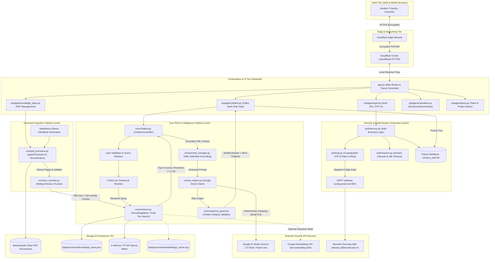
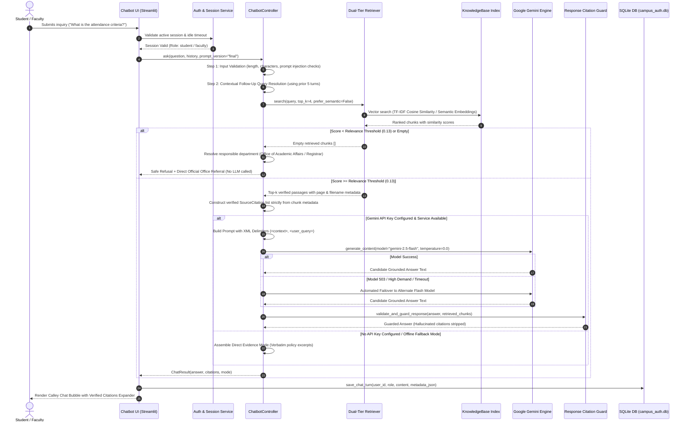
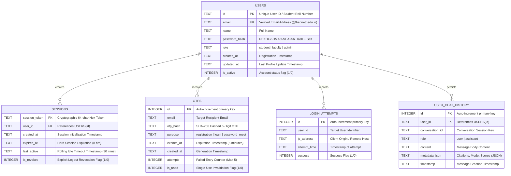
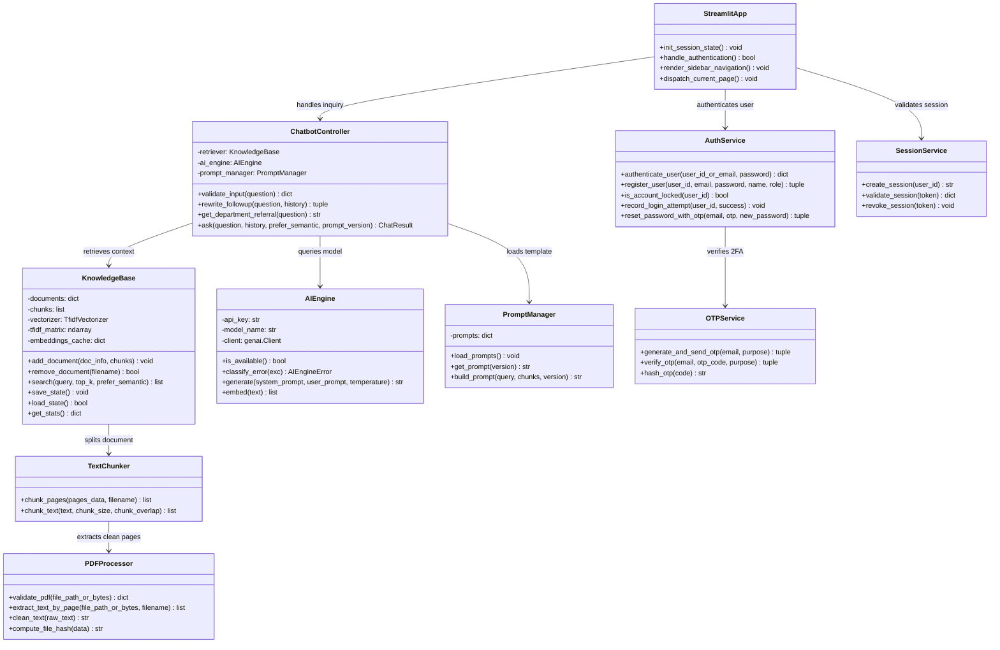

# System Architecture & Technical Design

This document details the architecture, data flows, security mechanisms, and component interactions of the **AI-Powered Campus Helpdesk Assistant**.

---

## 1. High-Level End-to-End System Architecture

The following diagram illustrates the complete multilayer architecture of the platform, from the client browser interface and Cloudflare edge network down through security, RAG pipeline, AI generation, and persistence layers.

---

## 2. Sequential Query & Grounded Retrieval Lifecycle

This sequence diagram depicts what occurs when a student asks a question—from rate limiting, query rewriting, threshold verification, fallback routing, Gemini generation, to citation validation.

---

## 3. Database Entity-Relationship (ER) Architecture

The platform uses a persistent, normalized SQLite relational database (`data/campus_auth.db`) with foreign key enforcement and automatic timestamp tracking.

---

## 4. Software Component & Class Topology

