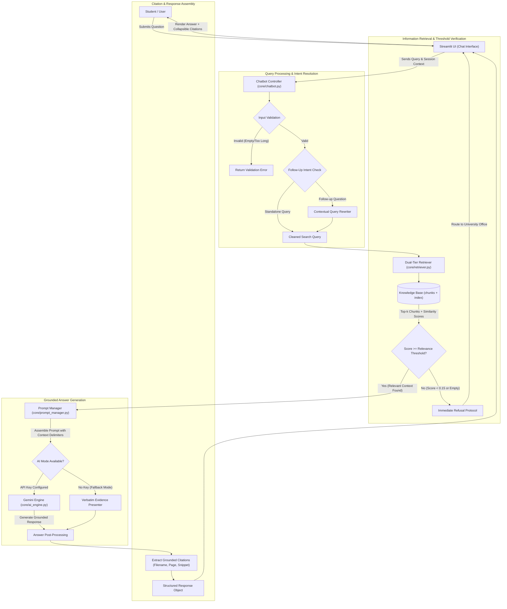
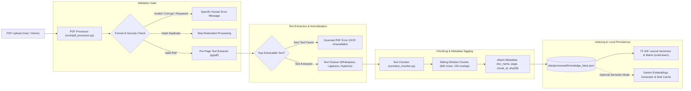
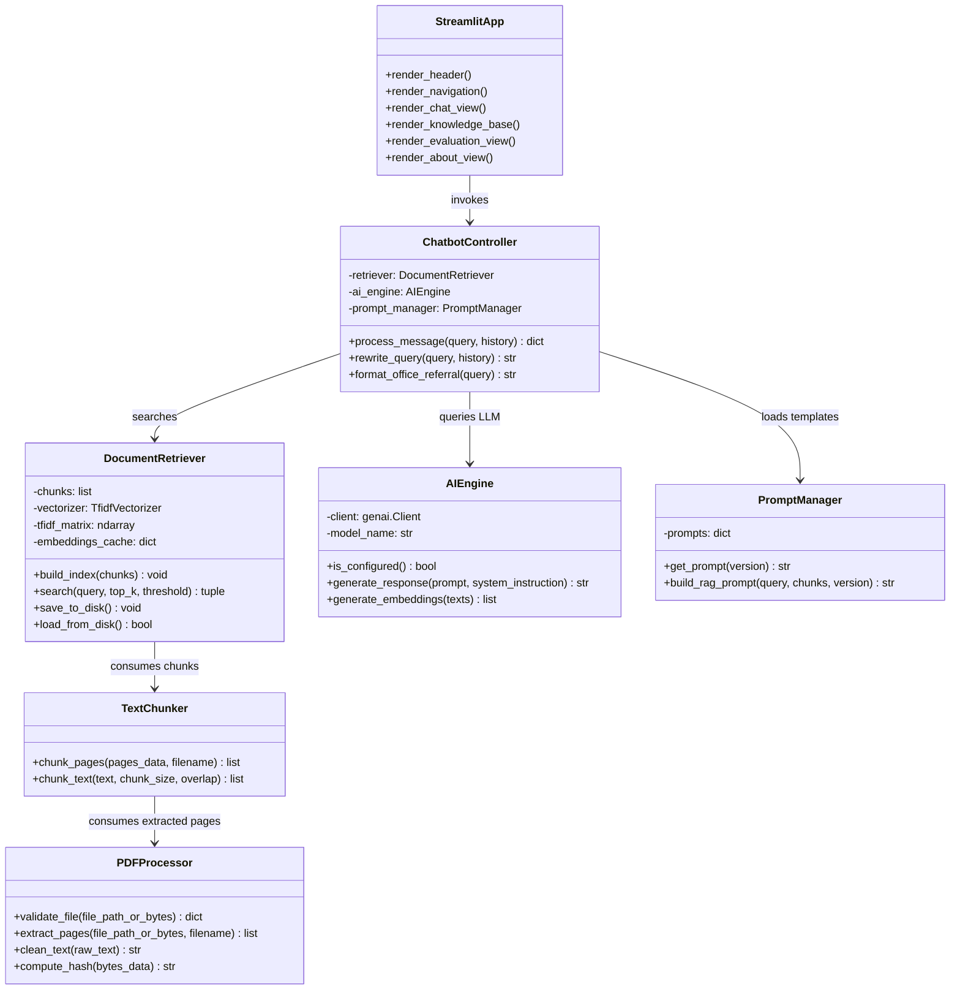

# System Architecture & Technical Design

This document details the architecture, data flows, and component interactions of the **AI-Powered Campus Helpdesk Assistant**.

---

## 1. High-Level Query & RAG Pipeline

---

## 2. Document Ingestion, Processing & Indexing Pipeline

---

## 3. Component Interaction & Class Topology

